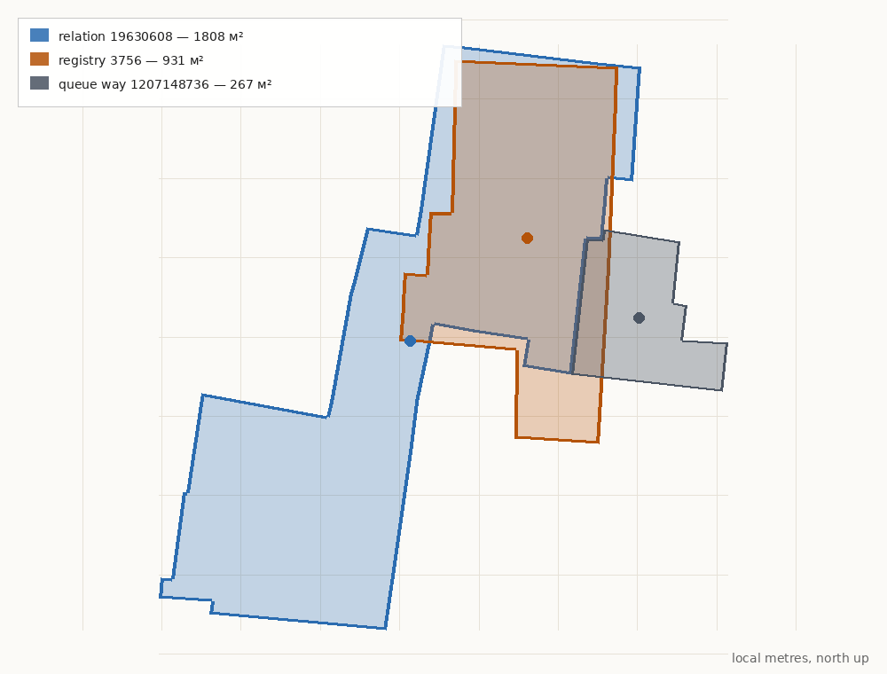

# Проблемный объект: баня № 5 («Грили абано»), реестр 3756

Разбор геометрии на примере кандидата №59. Это показательный случай: в очереди выбран не тот OSM-объект, официальная граница описывает не то же, что OSM-контур, а большая часть здания находится под землёй.

## Паспорт

| Поле | Значение |
|---|---|
| Номер очереди | 59 |
| ObjectID / RegistryN | 3756 / 4330 |
| Название | აბანო (გრილი აბანო) — «Баня (Грили абано)» |
| Адрес реестра | ул. Вахтанга Горгасали, 3 |
| Адрес OSM-отношения | ул. Абано, 2 |
| Дата | XVII век |
| Функция | восточная баня (первоначальная и текущая) |
| Статус | памятник культурного наследия |
| OSM-кандидат из очереди | [way/1207148736](https://www.openstreetmap.org/way/1207148736) |
| Правильный OSM-объект | [relation/19630608](https://www.openstreetmap.org/relation/19630608) |

Официальное описание прямо говорит: над землёй видны только купольные объёмы и выступы, а основная часть здания уходит под землю примерно на два этажа; в плане преобладают круги и кривые, два типа куполов, центральный вход. Это не обычный дом, у которого контур совпадает с пятном застройки.

## Три геометрии

| Геометрия | Площадь | Что описывает |
|---|---:|---|
| Официальная граница 3756 | 930,6 м² | Охраняемое ядро/участок, вытянутый с севера на юг |
| OSM relation 19630608 | 1808,4 м² | Весь комплекс бани, включая подземные объёмы и дворовые части |
| OSM way 1207148736 из очереди | 266,6 м² | Соседнее небольшое здание; к бане не относится |

### Отношения

| Пара | Пересечение | IoU | Вложенность | Смещение центроидов |
|---|---:|---:|---|---:|
| Официальная ↔ relation | 743,1 м² | **0,372** | 79,9% официальной внутри relation; 41,1% relation внутри официальной | 19,6 м |
| Официальная ↔ way из очереди | 63,4 м² | **0,056** | 23,8% way внутри официальной; 6,8% официальной покрыто way | 17,4 м |
| Relation ↔ way из очереди | 0 м² | **0,000** | не пересекаются | 29,0 м |

Главный вывод: **way из очереди вообще не пересекается с relation бани**. Это не «неточный контур», а другой объект. Официальная граница на 80% лежит внутри relation, но relation выходит далеко на юго-запад: это не «сдвиг», а разные объёмы — охраняемое ядро против всего комплекса.

### Размеры и форма

- Официальная граница: примерно 28 × 49 м, узкая вытянутая полоса.
- Relation: примерно 61 × 74 м, крупный комплекс с юго-западным расширением.
- Разница площадей — 878 м²; значительная часть relation лежит вне официальной границы.
- У relation один Polygon (6 outer-way собраны в замкнутый контур), но тег `layer=-1` означает подземный уровень.

## Почему так получилось

1. **Очередь строилась по OSM way, а баня — multipolygon relation.** Генератор взял ближайший way в радиусе ~17 м. Им оказался соседний дом 266 м²; настоящая баня описана отношением из шести внешних контуров. Это была системная проблема: коллектор умел только `way/<id>`. Теперь он поддерживает `relation/<id>` и явные исключения в `data/osm-candidate-overrides.json`; для №59 добавлено отношение 19630608.
2. **Официальная граница — не footprint здания.** Это охраняемая территория/ядро. Она может быть уже или шире фактического пятна, включать двор или исключать подземные части.
3. **OSM relation — не «здание» в бытовом смысле.** Он обводит весь комплекс, включая подземные залы и служебные объёмы. На карте он выглядит как крупный наземный блок, хотя большая часть скрыта.
4. **Адрес расходится.** Реестр — Горгасали, 3; relation — Абано, 2. Это может быть один комплекс на углу, но без адресного справочника/плана тождество не доказано.
5. **Классификация в городском списке противоречит реестру.** В PDF-списке строка 239 связывает Горгасали, 3 с «Grili Abano (Bath No. 5)» и XVII веком, но в графе типа стоит жилой дом. Вероятна ошибка строки/колонки, а не второй объект.

## Что это значит для карточки

Возможны четыре варианта, и ни один не является автоматическим:

| Вариант | Что показывать | Проблема |
|---|---|---|
| A. Официальная граница 931 м² | Охраняемое ядро | Это не контур здания; на карте будет участок |
| B. Relation 1808 м² | Весь комплекс | Включает двор/подземные объёмы; выглядит как наземный блок, дата «XVII век» для всей фигуры слишком сильное утверждение |
| C. Только видимые купола | Реальное пятно над землёй | Нужен отдельный обмер/контур; не покрывает охраняемый объект целиком |
| D. Не добавлять | — | Текущий hold: нет надземного контура |

Для атласа, где контур означает здание, **A и B в чистом виде не подходят**. C — лучший вариант для карты, но требует отдельной геометрии куполов. B допустим только как «комплекс бани» с явной пометкой, что polygon включает подземные и дворовые части.

**Решение: hold.** Правило проекта — primary-геометрия карточки должна быть надземным следом здания, потому что карта показывает именно его. Надземного контура куполов у нас нет; relation 1808 м² описывает комплекс с подземными и дворовыми объёмами, официальная граница 931 м² — охраняемое ядро. Показывать ни то, ни другое как footprint здания нельзя.

Вторичные контуры при этом не потеряны: официальная граница, relation и ошибочный way из очереди сохранены в `data/geometry-variants.json` с ролями `heritage_boundary`, `complex_underground`, `neighbor_wrong_candidate`. Когда появится обмер видимых куполов, его можно будет сделать primary, а остальные варианты сохранить для истории и проверки. Это и есть «перестроить представление по типу геометрии» без потери данных.

## Что осталось проверить

1. **Официальный план/ортодото:** что именно входит в 930 м² — только ядро, двор или купольная часть.
2. **Адрес:** Горгасали, 3 и Абано, 2 — один комплекс или соседние объекты; нужен адресный справочник/кадастр.
3. **Независимый профильный источник** о дате XVII века и функции; реестр и городской список — не независимы друг от друга.
4. **Обмер видимых куполов** или согласованное решение показывать relation как комплекс.
5. **Фото:** свободные снимки куполов есть, но они не подтверждают план; права на архитектуру отдельно.

## Чему это учит

- **IoU 0,06 — не «плохая геометрия», а сигнал, что выбран не тот объект.** После замены way на relation IoU стал 0,372, но и это не делает контур зданием.
- **Высокая вложенность не равна тождеству.** 80% официальной границы внутри relation означает лишь, что ядро — часть комплекса; 41% relation внутри официальной показывает, что большая часть комплекса выходит за охраняемую границу.
- **Для подземных и составных объектов** нужен либо тип «комплекс/сооружение», либо отдельная геометрия видимой части; текущая модель `Building` этого не различает.
- **Очередь должна поддерживать relations.** Иначе такие объекты будут систематически получать соседний way и отсеиваться по ложной причине.

## Что показывает Google

Проверка через Places API (New), 1 ноября 2026 года:

- Place ID `ChIJ4W1UAfcMREAR8OBxx-o-nd8`, название **«Серная баня № 5»**, адрес **3 Gorgasali Street**, координаты **41.6887256, 44.8112773**, статус `OPERATIONAL`, рейтинг 3,8 при 896 отзывах.
- Точка Google лежит **внутри и официальной границы, и relation**: 1,1 м от границы официального полигона, 4,8 м от границы relation. То есть Google подтверждает место и функцию, но не даёт контур.
- По тому же адресу 3 Gorgasali Google показывает ещё отель Tiflis Palace и ресторан Tiflis Veranda. Адрес сам по себе не различает корпуса; это ещё один аргумент не строить идентичность только на адресе.
- Фото места показывает вход с надписью «№5 BATH» и кирпичную стену, а не план куполов. Для проверки надземного пятна оно не подходит.
- Street View и Static Maps API в проекте не активированы, поэтому спутниковый/панорамный снимок через API получить не удалось. Это ограничение доступа, а не отсутствие места в Google.

Ссылка на карточку: [Google Maps, Серная баня № 5](https://maps.google.com/?cid=16113104219890901232). Данные Google использованы только для проверки; фото и текст не переносятся в атлас.

## Источники

- [Карточка реестра 3756](https://memkvidreoba.gov.ge/objects/immovable/immovableObject?id=3756)
- [Официальный список памятников Тбилиси, PDF](https://docs.tbilisi.gov.ge/architect/dzeglebis_sia.pdf), строка 239
- [OSM relation/19630608](https://www.openstreetmap.org/relation/19630608)
- [OSM way/1207148736](https://www.openstreetmap.org/way/1207148736) — ошибочный кандидат из очереди
- [Commons: Domes of Bath no. 5](https://commons.wikimedia.org/wiki/File:Domes_of_Bath_no._5,_ArmAg_(1).jpg) — свободный снимок куполов, права на архитектуру отдельно
