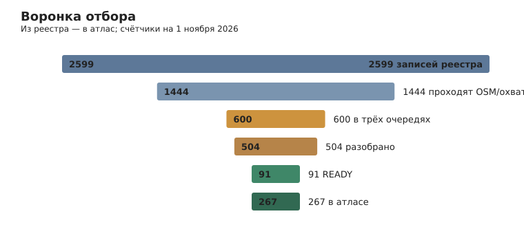
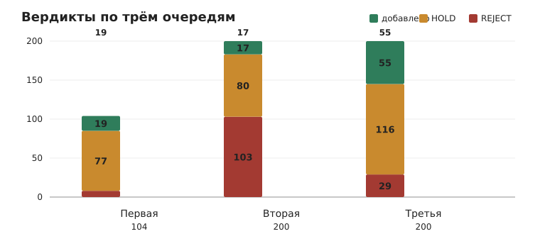
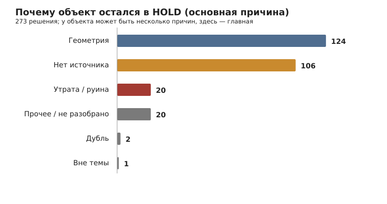
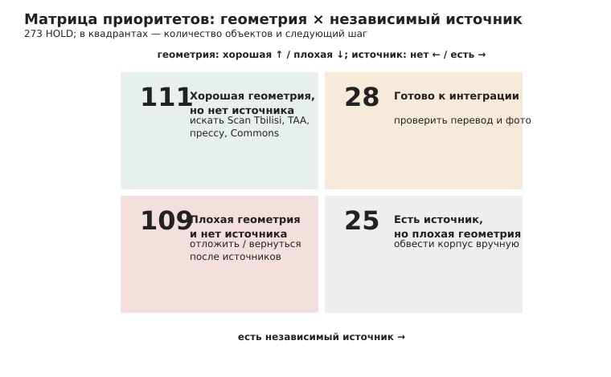
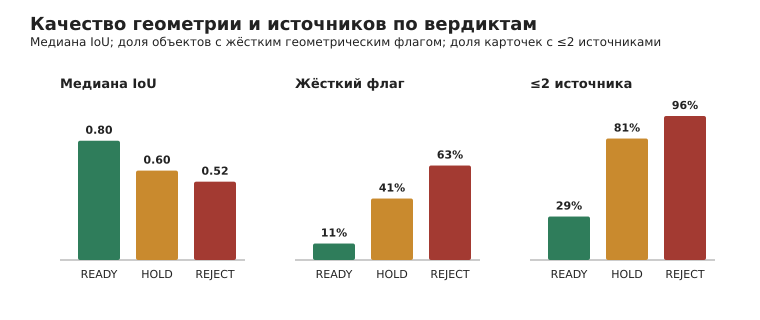
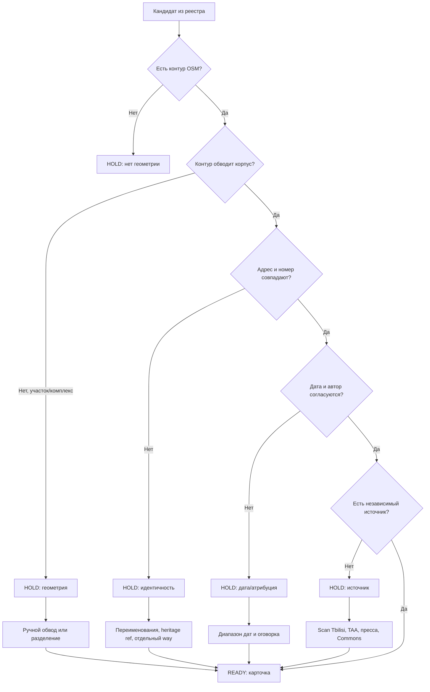

# Почему объекты остаются в HOLD

Сводный разбор трёх очередей: 600 кандидатов, 504 вердикта, 273 HOLD. Срез — 1 ноября 2026 года.

## Коротко

- **273 HOLD** в трёх очередях (77 + 80 + 116) и ещё 20 объектов, перенесённых из первой волны, — всего 293.
- Две причины закрывают **84%** случаев: грубая геометрия (**124**, 45%) и отсутствие независимого источника (**106**, 39%).
- Ещё **20** (7%) — утрата, руина или стройплощадка на месте памятника; **20** (7%) — прочее, включая неразобранные записи; **2** — риск дубля; **1** — вне темы.
- По данным геометрии: медиана IoU у READY — **0,795**, у HOLD — **0,596**, у REJECT — **0,522**. Жёсткий геометрический флаг или IoU < 0,55 — у **41%** HOLD и только у **11%** READY.
- **81%** HOLD имеют два источника и меньше (реестр + OSM); у READY таких **29%**. Это не приговор: в третьей волне для памятников с подробным реестровым описанием допускался READY по реестру.
- Практический вывод: **28 HOLD** можно интегрировать почти сразу (хорошая геометрия + независимый источник), **111** нужен только поиск источника, **25** — только новый контур, **109** — и то и другое.

## Как считали

Категория HOLD — это **главный блокер**, а не единственная причина. Почти у каждого объекта есть сопутствующие проблемы: адрес, дата, фото, конфликт имени. Поэтому в таблицах ниже одна и та же карточка может встречаться в нескольких сюжетах, а диаграмма причин показывает именно первичный блокер.

Приоритет категорий:

1. утрата/руина/снесено;
2. жёсткая геометрия (флаг `official_point_buffer`, `osm_composite_or_plot`, `osm_much_larger`, `osm_much_smaller`, `official_subset` или IoU < 0,55);
3. ошибка пары/адреса;
4. конфликт даты или атрибуции;
5. отсутствие независимого источника;
6. дубль, вне темы, прочее.

Источник данных — `work/queue*/verdicts.jsonl` и `collect.json`; сводка и примеры пересобираются скриптом `work/hold-audit/collect.py`.

| Причина | HOLD | Доля | Что это значит |
|---|---:|---:|---|
| Геометрия | 124 | 45% | Контур OSM обводит участок, комплекс, часть корпуса или реестровая «граница» — буфер точки |
| Нет независимого источника | 106 | 39% | Кроме реестра и OSM, нет публикации, путеводителя, прессы, музейной справки или Commons-подтверждения |
| Утрата / руина | 20 | 7% | Снесено, руинировано, на месте памятника стройплощадка |
| Прочее / не разобрано | 20 | 7% | Не хватило времени, неясная идентичность, дубль, вне темы |
| Дубль | 2 | 1% | Риск повторной карточки |
| Вне темы | 1 | 0,4% | Объект не является зданием |

## 1. Геометрия: 124 HOLD

Это самая частая и самая «механическая» причина. Реестр часто хранит не обмер корпуса, а точку с буфером 5 м или границу участка; OSM, наоборот, любит обводить двор с флигелями. Отсюда три типовых сюжета.

| Подтип | Сколько HOLD | Признак |
|---|---:|---|
| OSM-полигон больше корпуса | 77 | `osm_much_larger`; часто вместе с `osm_composite_or_plot` |
| Составной контур / участок | 50 | `osm_composite_or_plot`; в полигон попали двор, флигель, соседний корпус |
| OSM-полигон меньше корпуса | 31 | `osm_much_smaller`; обведено только уличное крыло |
| Реестровая «геометрия» — буфер точки | 27 упоминаний (7 с флагом) | 42–78 м², десятки вершин по окружности; IoU ничего не доказывает |
| IoU ниже 0,55 | 120 | Порог READY; ниже него пара «реестр ↔ OSM» считается недоказанной |

### Примеры

**Точечный буфер вместо корпуса.** Конституции, 4 / Ниношвили, 62 (реестр 15996). Реестровая граница — **77,7 м²**, 37 вершин по окружности; OSM `way/337421300` — 932 м², четыре этажа, другой адрес. IoU 0,083, флаги `osm_much_larger` и `osm_composite_or_plot`. Это не «плохое здание», а отсутствие обмера: реестр хранит точку, OSM — соседний корпус.

**Комплекс вместо дома.** Табидзе, 2 (реестр 4030). Реестр описывает два дома 276,8 м², OSM `way/1172799959` — **1141 м²** на два здания и двор, IoU 0,243. Пока контур не разделён, карточка не может честно показать один памятник.

**Потерянное крыло.** Агмашенебели, 122 (реестр 3185). OSM `way/1127960827` совпадает по адресу и центроиду, но покрывает только уличное крыло: **329,5 м²** против 508 м² реестра, IoU 0,526, `osm_much_smaller`. Нужен дворовый объём или явная оговорка «показан уличный корпус».

**Ошибка пары.** Чубинашвили, 40б (реестр 3043). OSM-контур с адресом 40б пересекает реестровую границу на **88,5 м²**, центроид в **23,9 м**, IoU 0,088. Реестр сам оговаривает, что по адресу два дома — 40 в глубине и 40б на улице; OSM обводит слитый корпус. Это не геометрия «плохая», это неверная пара.

**Буфер 72 м².** Бамбис, 8 (вторая очередь, n=4). Флаг `official_point_buffer`, реестровая площадь 72 м²; IoU 0,599 выглядит приличным, но он посчитан от точки, а не от обмера.

### Что делать

1. **Разделить комплекс на корпуса.** В OSM отметить отдельные way для каждого здания; для составного контура использовать `building:part` или ручной полигон. Это разблокирует 50 составных случаев.
2. **Достроить недостающее крыло.** Для `osm_much_smaller` (31) — обвести дворовое крыло или добавить второй way; для 124-Агмашенебели это буквально один полигон.
3. **Не считать IoU от буфера.** Если площадь реестровой границы 40–80 м² и много вершин по окружности, сразу запускать ручной обвод; 27 таких HOLD.
4. **Сверять адрес до геометрии.** Переименования (Сундукиана → Гамкрелидзе, Боржоми → Лебанидзе) подтверждаются актами Сакребуло; после нормализации часть «неверных пар» окажется верной.
5. **Реестровый полигон — только fallback.** Если OSM-контура нет, допустим реестровый полигон с пометкой `geometryQuality` и без ложного IoU.

## 2. Источник: 106 HOLD

Здесь объект часто архитектурно сильный: подробное описание декора, автор, дата, охранный статус — но всё это из одного реестра. Формально это проверяемый источник, однако для редакционной карточки нужен хотя бы один независимый: публикация, путеводитель, пресса, музейная справка, мемориальная доска, Commons-файл с привязкой.

**81%** всех HOLD (220 из 273) имеют ≤2 источников. У READY таких только 29%, и это в основном третья волна, где для памятников с подробным описанием допускался READY по реестру. То есть 106 — нижняя оценка дефицита, а не абсолютная цифра.

### Примеры

**Анаклия, 4** (реестр 2976, третья очередь). Геометрия чистая: IoU 0,863, центроид 1,8 м, флагов нет. Реестр подробно описывает «николаевский» кирпич, веерные перемычки, зубчатый карниз, металлический и «французский» балконы. Независимого источника и фото нет — HOLD.

**Чубинашвили, 20** (реестр 2978). Мемориальный дом: в 1917–1973 здесь жил академик Георгий Чубинашвили, основатель грузинского искусствознания. IoU 0,837, контур чистый. Нет публикации о доме или мемориальной справки — HOLD, хотя это один из самых перспективных объектов: достаточно музейной страницы или панорамы с доской.

**Джавахишвили, 71а** (реестр 3066, третья очередь). IoU 0,901, подробное описание, но единственный источник — реестр. В третьей волне такие объекты допускались до READY; в первой и второй — нет. Это главная методологическая развилка отчёта.

**Дом с надписью SALVE** (Курдиани, 17, вторая очередь). Богатый ампирный декор, надпись в вестибюле, IoU 0,91 — но ни одной публикации вне реестра. HOLD.

### Что делать

- **Пакетный поиск по адресу**: Scan Tbilisi, Tbilisi Architectural Archive, Грузинская энциклопедия, `site:` по адресу, Commons-категория улицы, WLM-файлы с GPS.
- **Мемориальные дома**: искать доску, музейную страницу, биографию жильца с адресом. Для Чубинашвили, 20 это один запрос.
- **Переименования**: акт Сакребуло № 417 от 25.08.2023 и решение о Боржоми → Лебанидзе дают независимую привязку адреса; этого достаточно для identity, но не для архитектурной ценности.
- **Разделить «источник идентичности» и «источник ценности»**: Scan Tbilisi с собственными фото подтверждает адрес и объём; реестр — декор и дату. Для READY достаточно первого + реестра, если в карточке явно сказать, что атрибуция реестровая.
- **Не добавлять «ещё один безымянный дом»** только по реестру: 111 HOLD с хорошей геометрией — это очередь на источник, а не на публикацию.

## 3. Утрата и руина: 20 HOLD

Это не «недостаток данных», а невозможность показать здание. В атлас нужен надземный корпус, а не пятно руины или стройплощадка.

**Примеры.** Лаборатория Ботсада (реестр 3466): OSM `way/549065841` помечен `ruined=yes` и покрывает 67% реестровой площади — обведён фрагмент. Бывший комбинат военного округа, Котэ Абхази, 29 (реестр 3647): на месте корпуса OSM показывает `building=construction`, `construction=hotel`, 7 уровней — историческое здание снесено. Руина оборонительной башни XVIII века (вторая очередь, n=16): сохранились глухие стены 1–1,5 м. Абанотубани, «ресторан, баня» (n=43): имя обезличено, контур покрывает 67% реестра.

**Что делать.** Не подменять руину контуром; фиксировать в реестре как «утрачено/руина», исключать из очереди на карточку. Если здание воссоздано — это новый объект с новой датой, а не старый памятник. Для ценных руин (стены, башни) нужен отдельный слой «археология/руины», а не карточка здания.

## 4. Дата и атрибуция: 70 упоминаний

Как первичный блокер дата почти не встречается — обычно она идёт вместе с геометрией или источником. Но конфликты дат мешают и там, где всё остальное в порядке.

**Примеры.** Банк «Инвести» (реестр 3332): `ExactDate` — «конец XX века», описание — начало XX века, фасад с коринфскими пилястрами и гербом выглядит дореволюционным; HOLD по дате. Дом на Чубинашвили, 23а (реестр 2950): поле «начало XIX в.», описание «начало XX в.», функция «2-я половина XIX в.» — три даты в одной записи. Дом на Цинамдзгвришвили, 38 / Роми, 23 (реестр 2718): `ExactDate` «начало XX в.» против `InitialFunction` «1960–1991». Церкви 1996–1997 годов (вторая очередь, n=89 и 96) — новодел при сохранённой стене; самые поздние карточки атласа — 1980 год, поэтому они HOLD по хронологии, а не по качеству.

**Что делать.** Ввести правило: `ExactDate` — только если совпадает с описанием; иначе диапазон и явная оговорка. Разделить «построено» и «перестроено». Для современного новодела — либо расширить хронологию атласа, либо не добавлять. Для конфликта «поле vs текст» приоритет у текста с конкретной деталью (надпись, архивный проект), но с пометкой.

## 5. Адрес и идентичность: 144 упоминания

Адрес — сквозная проблема: он встречается в 144 HOLD, но первичным блокером стал только там, где пара «реестр ↔ OSM» неверна.

**Примеры.** Узнадзе, 54 → дом Берты и Артура фон Зутнер: OSM-контур обводит участок 839,6 м² против 252,5 м² корпуса, IoU 0,284. Агмашенебели, 83 / Марджанишвили, 23 (реестр 2958): OSM `way/246754287` — это Агмашенебели, 29, пересечение 0, IoU 0,0, centroids 33 м; объект сильный (арх. М. Мелиа), но пара неверна. Чубинашвили, 40б: IoU 0,088, 23,9 м. Сундукиана, 22 / Гамкрелидзе, 20: OSM-контур относится к другому дому, IoU 0,001.

**Что делать.** Нормализовать адрес до улицы и номера, проверить переименования по актам, сопоставлять по `heritage`/`ref`/Wikidata, а не только по адресу. Если пара неверна — не «подгонять» IoU, а искать отдельный way или использовать реестровый полигон с пометкой.

## 6. Прочее: 20 HOLD

Сюда попали записи, которые не успели разобрать (третья очередь, n=194 хлебопекарня и n=199 общественное здание), неясная идентичность, риск дубля (Литературный музей, вторая очередь n=12; клиника/церковь, n=85) и единичные вне темы. Это не отдельная категория качества, а «долг очереди»: 2 объекта нужно просто добить, 18 — перепроверить пару и описание.

## Где инвестировать: матрица приоритетов

| Квадрант | HOLD | Что делать | Ожидаемый результат |
|---|---:|---|---|
| Хорошая геометрия + независимый источник | **28** | Проверить перевод, фото, дату; собрать карточку | 20–28 карточек почти без исследования |
| Хорошая геометрия, источника нет | **111** | Пакетный поиск источника; для памятников — реестр + оговорка | 20–35 карточек |
| Плохая геометрия + источник | **25** | Ручной обвод корпуса, разделение комплекса | 15–20 карточек |
| Плохая геометрия, источника нет | **109** | Отложить; возвращаться только по ценности | 5–10 карточек |

## План преодоления

| Шаг | Действие | Кого закрывает | Трудоёмкость | Когда делать |
|---|---|---|---|---|
| 1 | Разобрать 28 «быстрых» HOLD: перевод, фото, дата | 28 | 1–2 дня | Сразу |
| 2 | Пакетный поиск источников по 111 объектам (Scan Tbilisi, TAA, пресса, Commons) | 111 | 2–3 дня | Сразу после шага 1 |
| 3 | Ручной обвод 25 объектов с источником; разделить составные контуры | 25 | 2–3 дня | Параллельно |
| 4 | Закрыть 20 утрат/руин: исключить, не трассировать | 20 | 1 день | Сразу |
| 5 | Добить 20 «прочих»: 2 неразобранных, дубли, идентичность | 20 | 1–2 дня | После шага 2 |
| 6 | Для 109 «двойных» — только выборочно, по архитектурной ценности | 109 | не планировать целиком | По запросу |

**Реалистичный итог:** 28 + 20–35 + 15–20 ≈ **63–83 карточки** из 273 HOLD без новых полевых исследований. Остальные 190–210 требуют архива, натуры или отдельного слоя «руины/утраты».

## Топ-10 на разблокировку

| Объект | Реестр | IoU | Что мешает | Что сделать |
|---|---|---:|---|---|
| Дирекция Национальной библиотеки, Гудиашвили, 7 / Пурцеладзе, 10 | [4386](https://memkvidreoba.gov.ge/objects/immovable/immovableObject?id=4386) | 0,932 | Только реестр | Один источник: TAA/Scan/пресса |
| Госпиталь ветеранов, Яманидзе, 3 | [5007](https://memkvidreoba.gov.ge/objects/immovable/immovableObject?id=5007) | 0,775 | Только реестр | Источник + фото |
| Клиника ветеранов, Яманидзе, 3 | [5008](https://memkvidreoba.gov.ge/objects/immovable/immovableObject?id=5008) | 0,741 | Только реестр | Источник + фото |
| Детский сад №22, Цурцумиа, 14 | [3411](https://memkvidreoba.gov.ge/objects/immovable/immovableObject?id=3411) | 0,817 | Только реестр | Источник |
| Балетная школа Чубукиани, Чубинашвили, 49 | [3100](https://memkvidreoba.gov.ge/objects/immovable/immovableObject?id=3100) | 0,850 | OSM `construction`, только реестр | Проверить статус стройки/реконструкции |
| Бывшее кафе-шантан, Муштаид, 182 | [3187](https://memkvidreoba.gov.ge/objects/immovable/immovableObject?id=3187) | 0,601 | Контур больше корпуса | Обвести зал, источник |
| Здание Сакребуло, Табидзе, 2 | [4030](https://memkvidreoba.gov.ge/objects/immovable/immovableObject?id=4030) | 0,243 | Комплекс из двух зданий | Разделить контуры, источник |
| Бассейн «Лагуна Вере», Костaва, 34 | [16003](https://memkvidreoba.gov.ge/objects/immovable/immovableObject?id=16003) | 0,091 | Контур только часть | Обвести корпус, источник |
| Дом М. Мелиа, Агмашенебели, 83 / Марджанишвили, 23 | [2958](https://memkvidreoba.gov.ge/objects/immovable/immovableObject?id=2958) | 0,000 | Неверная пара OSM | Найти way дома 83 |
| Дом Чубинашвили, 20 | [2978](https://memkvidreoba.gov.ge/objects/immovable/immovableObject?id=2978) | 0,837 | Только реестр | Мемориальная доска/музейная страница |

## Схема решения

## Ограничения

- Категории эвристические: один HOLD может иметь 2–3 равноправные причины. Цифры «геометрия 124» и «источник 106» — это **первичный** блокер, а не общее число упоминаний.
- В первой и второй волнах действовал строгий порог «независимый источник»; в третьей для памятников с подробным реестровым описанием допускался READY по реестру. Поэтому 106 — нижняя оценка, а не абсолютная.
- IoU считается по реестровой границе; если она является буфером точки, IoU не показателен. Такие случаи отмечены отдельно (27 упоминаний, 7 с флагом).
- 20 HOLD первой волны, перенесённых из более раннего прохода, не входят в 273 таблицы вердиктов; в тексте они упоминаются как «перенесённые».
- Оценки «20–35 карточек» — экспертные, не гарантия: источник может не найтись и после пакетного поиска.

## Приложение

- Диаграммы: `docs/images/hold-verdicts-by-wave.svg`, `hold-reasons.svg`, `hold-quality.svg`, `hold-matrix.svg`, `hold-funnel.svg`.
- Данные: `work/hold-audit/holds.json` (273 записи), `work/hold-audit/summary.json`.
- Скрипты: `work/hold-audit/collect.py`, `work/hold-audit/charts.py`.
- Очередь 4: `docs/research-next-200-v4.md` (200 лучших оставшихся безымянных жилых домов; факты собраны).
