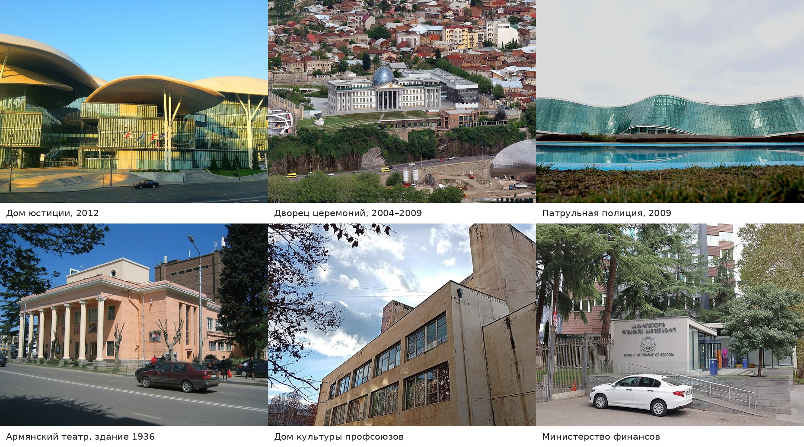

# Публичные и правительственные здания: обязательный пул и первый разбор

Снимок: 7 ноября 2026 года. Повод: Дом юстиции не попал в атлас не потому, что он современный, а потому что автоматический отбор OSM пропускал только объекты с `heritage`/`historic`, а в реестре памятников его нет. Новое правило закрывает этот пробел: публичные и правительственные здания входят в пул кандидатов до оценки значимости.

Правило зафиксировано в [AGENTS.md](../AGENTS.md), [location-data-collection.md](location-data-collection.md#обязательный-пул-публичных-и-правительственных-зданий) и [research-pipeline.md](research-pipeline.md); селектор `scripts/research-heritage.py` больше не отбрасывает такие объекты. Пул — это очередь на разбор, а не список карточек: типовая налоговая или районная управа может получить HOLD/REJECT, но не может быть отсеяна только из-за отсутствия охранного тега.

## Метод и охват

Источник — полный слой `raw/osm/osm-tbilisi-building-outlines.geojson` (121 313 контуров), а не только центральная сетка. В пул включены контуры с любым из тегов:

- `building=public`;
- `building=government`;
- `building=civic`;
- `office=government`;
- `government=*`.

Для каждого кандидата сохранены имя, адрес, координаты, площадь, теги, дата, архитектор, Wikidata, Commons, пересечение с текущими карточками атласа и ближайшая запись официального реестра (в радиусе 40 м, автоматическое сопоставление). Полный реестр — [research-public-buildings.csv](../data/research-public-buildings.csv); рабочий скрипт разбора — разовый, лежит в `work/public-buildings/` и в Git не входит.

| Показатель | Значение |
|---|---:|
| Всего контуров в пуле | **202** |
| `building=public` | 131 |
| `building=government` | 37 |
| `building=civic` | 13 |
| Только `office=government` (без трёх значений выше) | 21 |
| С именем хотя бы на одном языке | **56** |
| Уже пересекаются с карточкой атласа | **16** |
| С Wikidata | 16 |
| С датой | 7 |
| С архитектором в OSM | 4 |
| С реестровой записью в радиусе 40 м | 63 |
| Без имени | 146 (114 с адресом, 32 без) |

Главный вывод: тег действительно редкий (0,17% городских контуров), но как сигнал значимости слабый. В пуле одновременно Дом юстиции Фуксаса, Национальный архив с авторской архитектурой и десятки типовых налоговых и районных управ. Поэтому ниже — не «все 202 достойны карточки», а разделение на приоритет, типовое и пробелы.

## Фотоподборка

*Слева направо, сверху вниз: Дом юстиции (2012), Дворец государственных церемоний (2004–2009), Департамент патрульной полиции (2006–2009), Тбилисский армянский театр (здание 1936), Дом культуры профсоюзов, Министерство финансов. Подборка — производное изображение; исходные снимки используются по лицензиям, указанным ниже.*

| Объект | Автор | Лицензия | Источник |
|---|---|---|---|
| Дом юстиции | Max Benidze | CC BY-SA 2.0 | [Commons](https://commons.wikimedia.org/wiki/File:Public_Service_Hall_(34559549093).jpg) |
| Дворец церемоний | Alexxx1979 | CC BY-SA 4.0 | [Commons](https://commons.wikimedia.org/wiki/File:Tbilisi_Presidential_Palace_IMG_8977_1920.jpg) |
| Патрульная полиция | Malkhaz Tchubabria | CC BY-SA 4.0 | [Commons](https://commons.wikimedia.org/wiki/File:Patrol_Police_Department.jpg) |
| Армянский театр | Gika B | CC BY 2.0 | [Commons](https://commons.wikimedia.org/wiki/File:Petros_Adamian_Tbilisi_State_Armenian_Drama_Theatre._Avlabar,_Tbilisi,_Georgia.jpg) |
| Дом культуры профсоюзов | Yuri Samoylov | CC BY-SA 4.0 | [Commons](https://commons.wikimedia.org/wiki/File:2024-12-17_Trade_Unions_House_of_Culture_from_east.jpg) |
| Министерство финансов | Александр Сигачёв | CC0 | [Commons](https://commons.wikimedia.org/wiki/File:Tbilisi_-_Minister_of_Finance_of_Georgia_-_2025-10.jpg) |

Это не готовые галереи: для карточек нужны три разных проверенных кадра, а у части объектов есть только один ракурс или фото с чужой вывеской. Права на архитектуру (Фуксас, Де Лукки) требуют отдельной проверки, даже когда фотография свободная.

## Приоритет: что разбирать первым

Шкала значимости: **A** — авторский объект или историко-культурный landmark; **B** — заметный институциональный объект или градостроительный ориентир, требующий проверки; **C** — типовое учреждение без подтверждённой архитектурной ценности; **A/B** — промежуточная оценка. Вердикты: **READY** — можно готовить черновик карточки; **HOLD** — не хватает данных, фото или идентичности; **ALREADY** — уже в атласе.

| Объект | Адрес | Дата / автор | Значимость | Фото | Вердикт |
|---|---|---|---|---|---|
| **Дом юстиции** (`way/1066392731`) | набережная Звиада Гамсахурдиа, 1 | 2012; Массимилиано Фуксас | **A.** Авторский гражданский объект, один из символов современной архитектуры Тбилиси; 7 этажей, 8 202 м² | Commons: несколько ракурсов, есть интерьер | **ALREADY**: карточка `osm-1066392731` добавлена 7 ноября 2026 года, три фото |
| **Дворец государственных церемоний** (`way/362739744`) | улица Малхаза Абдушелашвили, 1 | 2004–2009; Георгий Батиашвили, завершение — Микеле Де Лукки; реконструкция бывшей императорской жандармерии | **A.** Резиденция/дворец, ключевой объект Де Лукки; 3 этажа | Commons: два общих вида | **ALREADY**: карточка `osm-362739744`, два фото |
| **Национальный архив Грузии** (`way/1236099523`) | проспект Важа-Пшавела, 1 | проект 1952–1966, строительство 1961–1967; Valeria Hajibeili, инженер N. Meskhi | **A.** Один из лучших примеров переходной грузинской архитектуры; монументальная башня, керамические рельефы | Commons: один общий вид | **ALREADY**: карточка `osm-1236099523`, одно фото |
| **Департамент патрульной полиции** (`way/169088820`) | улица Ноэ Рамишвили, 38 | 2006–2009; aMDL Michele De Lucchi, Freyrie & Pestalozza | **A.** Стеклянная «волна» над искусственным рвом, авторский объект | Commons: один общий вид | **ALREADY**: карточка `osm-169088820`, одно фото |
| **Тбилисский армянский театр** (`way/56689025`) | проспект Царицы Кетеван, 8 | театр с 1856 года; собственное здание в Авлабаре с 1936 года; автор не установлен | **A/B.** Культурно-историческая значимость, неоклассический фасад, реставрация | Commons: два кадра | **HOLD**: нет автора и точной даты здания, реестровая запись не найдена |
| **Дом культуры профсоюзов** (`way/463044249`) | улица Фердинанда Тавадзе, 1а | дата и автор не установлены; советский модернизм, мозаика | **B.** Крупный советский модернизм, 5 этажей, 3 709 м² | Commons: три кадра | **HOLD**: нет даты, автора и статуса |
| **Национальная научная библиотека** (`way/58073770`) | 2-й переулок Мераба Алексидзе, 3 | 1970 (OSM); автор не установлен | **B.** Советский модернизм, библиотека; 5 этажей | Нет проверенного кадра | **HOLD**: у библиотеки три корпуса, нужно подтвердить идентичность |
| **Министерство здравоохранения** (`way/56397411`) | проспект Акакия Церетели, 144 | дата и автор не установлены | **B.** 21-этажная башня, градостроительный ориентир | Нет | **HOLD**: нужны дата, автор, фото |
| **Министерство финансов** (`way/65745048`) | улица Вахтанга Горгасала, 16 | дата и автор не установлены | **B.** 16-этажное правительственное здание | Commons: только вход | **HOLD**: нужны дата, автор, общий вид |
| **Дом быта** (`way/26445051`) | проспект Давида Гурамишвили, 15 | дата и автор не установлены | **B.** Крупный советский модернизм, 6 этажей, 5 773 м² | Нет | **HOLD**: нужны дата, автор, фото |
| **Служба государственной безопасности** (`way/34142209`) | проспект Важа-Пшавела, 72 | 2015 (OSM); автор не установлен | **B.** Крупный комплекс, 7 783 м² | Файл в OSM подписан как другой объект | **HOLD**: проверить контур и найти корректное фото |
| **МВД, 9 Апреля, 4** (`way/75316066`) | улица 9 Апреля, 4 | начало XX века, 1930; автор не установлен | **A/B.** Реестр № 4079, памятник; историческое здание бывшего Министерства безопасности | Нет | **HOLD**: нужны фото, автор, проверка современного состояния |
| **Нацагентство охраны памятников** (`way/56677905`) | улица Реваза Табукашвили, 5/7 | 1890–1902; автор не установлен | **B.** Реестр № 4239, памятник; поздняя эклектика | Нет | **HOLD**: сверить адрес (реестр — 5, OSM — 7), найти фото |
| **A. Khorava Actor's House** (`way/159818806`) | улица Георгия Леонидзе, 11а | XIX век; автор не установлен | **B.** Исторический дом, 1 492 м² | Нет | **HOLD**: реестр № 4121 относится к дому № 15, идентичность не подтверждена |

## Источники приоритетных объектов

- **Дом юстиции:** [Studio Fuksas](https://fuksas.com/tbilisi-service/), [Wikidata Q136433302](https://www.wikidata.org/wiki/Q136433302), [OSM way/1066392731](https://www.openstreetmap.org/way/1066392731).
- **Дворец государственных церемоний:** [Administration of the President — History](https://president.spl.ge/en/ThePalace/History.html), [Ceremonial Palace of Georgia](https://en.wikipedia.org/wiki/Ceremonial_Palace_of_Georgia), [OSM way/362739744](https://www.openstreetmap.org/way/362739744).
- **Национальный архив:** [TAA — National Archives of Georgia](https://taa.net.ge/en/archive-geo/national-archives-of-georgia/), [OSM way/1236099523](https://www.openstreetmap.org/way/1236099523).
- **Патрульная полиция:** [AMDL Circle — MIA and Patrol Police Headquarter](https://amdlcircle.com/en/projects/ministry-of-internal-affairs-of-georgia-and-patrol-police-headquarter/), [OSM way/169088820](https://www.openstreetmap.org/way/169088820).
- **Армянский театр:** [Тбилисский государственный армянский драматический театр имени П. Адамяна](https://ru.wikipedia.org/wiki/Тбилисский_государственный_армянский_драматический_театр_имени_П._Адамяна), [OSM way/56689025](https://www.openstreetmap.org/way/56689025).
- **Национальная научная библиотека:** [National Science Library (Georgia)](https://en.wikipedia.org/wiki/National_Science_Library_%28Georgia%29), [OSM way/58073770](https://www.openstreetmap.org/way/58073770).
- **МВД, 9 Апреля, 4:** [реестр, запись 4079](https://memkvidreoba.gov.ge/objects/immovable/immovableObject?id=4079), [OSM way/75316066](https://www.openstreetmap.org/way/75316066).
- **Нацагентство охраны памятников:** [реестр, запись 4239](https://memkvidreoba.gov.ge/objects/immovable/immovableObject?id=4239), [OSM way/56677905](https://www.openstreetmap.org/way/56677905).
- **A. Khorava Actor's House:** [OSM way/159818806](https://www.openstreetmap.org/way/159818806); реестр 4121 относится к соседнему дому № 15 и не подтверждает идентичность.
- **Минздрав, Минфин, Дом быта, СГБ:** в OSM есть контур и теги, но нет независимого источника на дату и авторство; это и есть причина HOLD.

## Что уже в атласе

С тегом пересекаются 16 существующих карточек: Канцелярия правительства, Дворец искусств, Дворец Орбелиани, Национальная галерея, Старая Ратуша, бывший Телеграф, Центр Микеладзе и администрация Мтацминда. Ещё восемь контуров — безымянные жилые дома на Агмашенебели и Цинамдзгвришвили, детский сад, бывшая Вторая гимназия, историческое здание на Беридзе и МИД.

Эта проверка важна сама по себе: **восемь из шестнадцати** пересечений — жилые дома, детсад, историческое здание, бывшая гимназия и МИД. Тег `building=public` в Тбилиси часто описывает функцию или владельца, а не архитектурный тип, и иногда просто устарел. Поэтому пул не может автоматически превращаться в карточки.

## Остальные 34 именованных и 146 безымянных

За пределами приоритетной таблицы остаются 34 именованных объекта: пять отделений Налоговой службы, районные управы Ваки и Исани, службы занятости и ветеранов, экстренные центры, Агентство госзакупок, Агентство охраняемых территорий, Минюст, Публичный реестр, Генпрокуратура, МВД на Гулуа, Минрегионразвития, Минкультуры, Счётная палата, Специальная следственная служба, Пенитенциарная служба, Национальная парламентская библиотека, Городской архив, Театр кукол, администрация Ботанического сада, Медиатека Варкетили и другие. По умолчанию это **C/HOLD**: типовые учреждения без подтверждённой архитектурной атрибуции. Исключения, которые стоит вернуть в приоритет после проверки: Минюст, Публичный реестр и Генпрокуратура на Горгасала, МВД на Гулуа и Счётная палата — они формируют правительственный квартал, но по отдельности требуют даты, автора и общего вида.

146 безымянных контуров не отброшены: 114 имеют адрес, 32 — нет. Восемь из них уже в атласе. Самые крупные — Меликишвили, 12 (2 715 м²), Цинамдзгвришвили, 117 (комплекс из нескольких корпусов) и Дадиани, 26 (1 975 м²); это приоритет для проверки по адресу и текущей функции. До неё они остаются HOLD, а не REJECT.

## Что дальше

1. **Все четыре READY добавлены**: Дом юстиции (`osm-1066392731`), Дворец церемоний (`osm-362739744`), Национальный архив (`osm-1236099523`) и Патрульная полиция (`osm-169088820`). Фото-пробелы остаются: у Дворца два общих вида, у Архива и Патрульной полиции по одному; для полной галереи нужны дополнительные кадры.
2. **Стиль.** `contemporary` используется для Дома юстиции и Патрульной полиции; у Дворца основной стиль — неоклассицизм с современным стеклянным куполом. Для Де Лукки можно позже уточнить `high-tech`, но не записывать его в `postmodernism` только потому, что он есть в справочнике.
3. **Фото.** У Национального архива и Патрульной полиции пока по одному кадру, у Дворца — два общих вида; нужны дополнительные ракурсы. У Армянского театра, Минфина и СГБ ситуация хуже: проверенных общих видов нет или файл относится к другому объекту.
4. **Проверить идентичность.** Армянский театр (1936), Национальная библиотека (три корпуса), МВД на 9 Апреля (реестр 4079), Нацагентство (адрес 5 или 7) и Actor's House (реестр 4121 — соседний дом) требуют сверки корпуса, а не только координаты.
5. **Не добавлять всё.** Пул из 202 контуров — это страховка от пропусков, а не очередь на 202 карточки. Следующий проход — по 34 именованным и крупным безымянным, с фото и источником на каждый.
